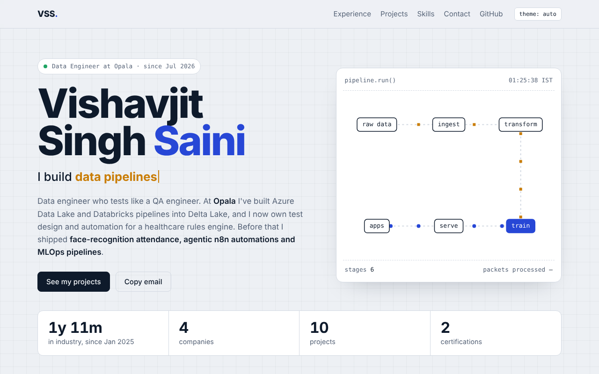
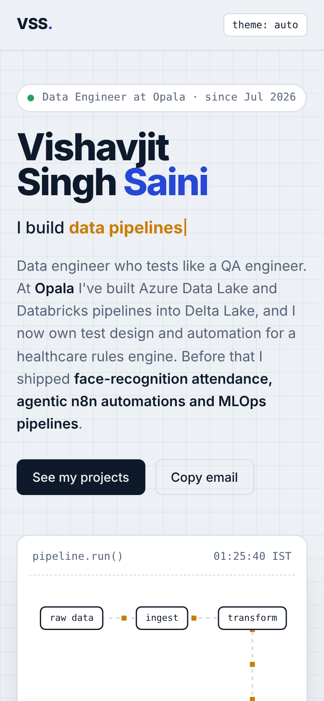

# Vishavjit Singh Saini · Portfolio

Personal portfolio site for **Vishavjit Singh Saini**, Data Engineer at Opala. It covers Azure and Databricks data engineering, API test automation, machine learning, computer vision and agentic automation.

**Live site:** https://vishavjit-singh.github.io/portfolio/

<p>
  
  
</p>

## Features

- **Live pipeline animation** in the hero, drawn on `<canvas>`: data packets flow from raw data → ingest → transform → train → serve
- **Career run log**: an expandable timeline of roles and projects
- **Queryable projects**: filter by area, or click any skill to highlight the projects that used it
- **Live details**: time in industry is computed from the start date, plus an IST clock
- **Light / dark / auto theme**, remembered per browser
- Responsive down to phone width, keyboard-accessible, and respects `prefers-reduced-motion`
- One self-contained `index.html`: no build step and no framework. Only Google Fonts load from outside

## Tech

HTML5 · CSS (custom properties, grid, `color-mix`) · vanilla JavaScript · Canvas 2D

## Run locally

```bash
git clone https://github.com/vishavjit-singh/portfolio.git
cd portfolio
python -m http.server 8000   # then open http://localhost:8000
```

## Deploy

The site is static. It is served by **GitHub Pages** from the `main` branch root (Settings → Pages → Deploy from a branch → `main` / `/ (root)`). It also works as-is on Cloudflare Pages, Netlify or any static host.

## Versions

| Version | Notes |
|---|---|
| **v2.0** (current) | Redesigned single-page portfolio with interactive projects and skills, updated for the Data Engineer role at Opala |
| v1.0 | Original sidebar CV page (HTML, CSS, Feather Icons). Kept in [`v1/`](v1/) |

## Contact

✉️ singhvishavjit03@gmail.com · [LinkedIn](https://www.linkedin.com/in/vishavjit-singh-7011211ab/) · [GitHub](https://github.com/vishavjit-singh)
